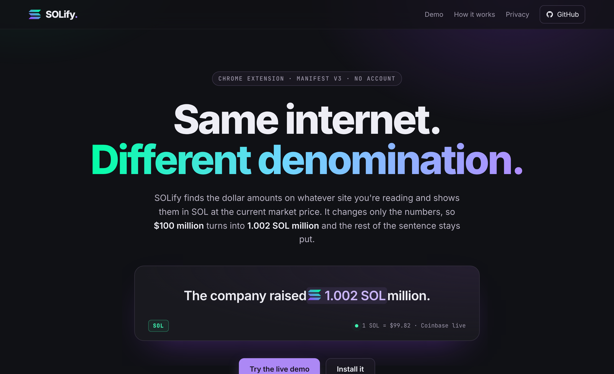
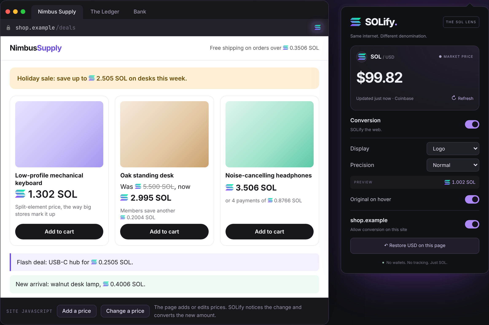
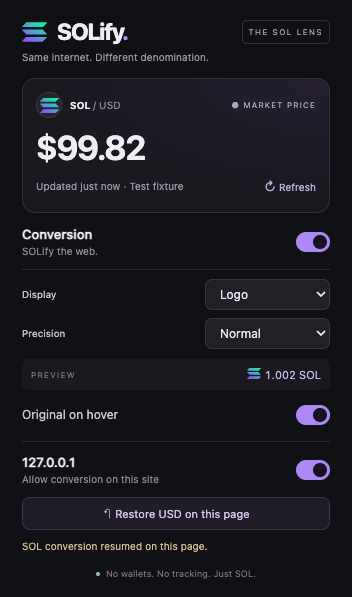
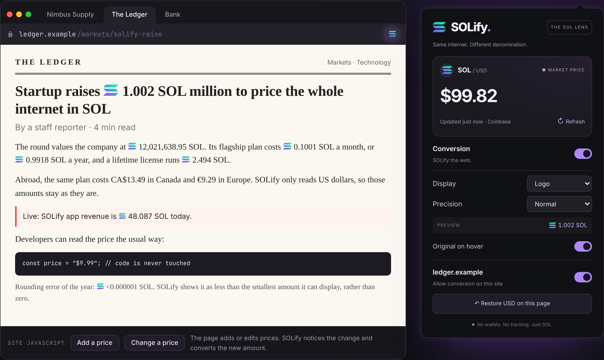
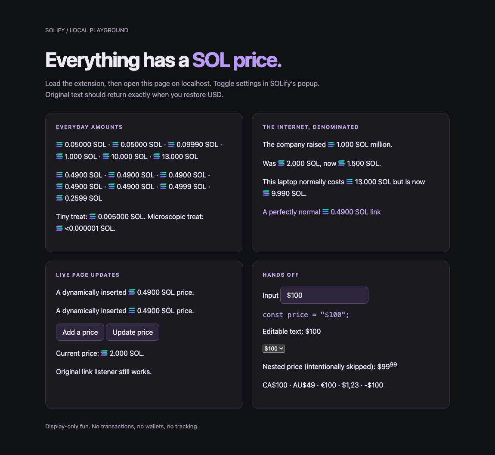

<div align="center">


# SOLify

**Same internet. Different denomination.**

A Chrome extension that shows every dollar price on the web in SOL. `$100 million` becomes `1.002 SOL million`, and the rest of the sentence stays exactly as it was.

[](https://github.com/ztxv/usd-to-sol-converter-extension/actions/workflows/check.yml)


### [**▶ Try the live demo at solify-extension.vercel.app**](https://solify-extension.vercel.app/)

[Install](#install) &nbsp;·&nbsp; [How it works](#how-it-works) &nbsp;·&nbsp; [Privacy](#privacy-and-permissions) &nbsp;·&nbsp; [Demo site](#demo-site)

</div>

<p align="center">
  
</p>

<p align="center">
  
</p>

<p align="center"><sub>Screenshots use a fixed test quote of $99.82 per SOL. They are not live market prices.</sub></p>

---

## About

SOLify runs on every normal website you visit. It finds the US dollar amounts and shows them in SOL at the current market price. Product pages, news articles and pricing tables all work. It only swaps the number, so the page reads exactly the same, just in a different currency.

It's for fun and display only. There's no wallet, no account and no trading. Your bank, broker and crypto exchange are left alone.

## Features

- **Reads real-world prices.** `$5`, `$1,299.99`, `US$49`, `USD 49`, `49 USD`, several amounts in one sentence, and the split-element prices big stores use.
- **Three display styles.** **Logo** (inline Solana mark, the default), **Clean** (`1.002 SOL`) and **Ticker** (`1.002 $SOL`).
- **Three precision modes.** **Meme** (2 decimals), **Normal** (adapts to the size of the amount) and **Autistic** (every digit JavaScript gives you). Tiny amounts show as `<0.000001 SOL` instead of a misleading zero.
- **Hover for the original.** Every converted amount keeps its original USD text in a tooltip.
- **Restores perfectly.** *Restore USD on this page* puts back the exact original text, character for character, until you resume or reload.
- **Keeps up with live pages.** A batched `MutationObserver` converts prices the site adds or changes later, without polling.
- **Protects financial sites.** A built-in list of banks, brokers, exchanges, payment apps and tax portals is never touched. You can switch off any other site with one click.
- **Never breaks the page.** Inputs, editable text, code blocks, hidden text, links and the page's own JavaScript keep working.
- **Zero dependencies.** Plain HTML, CSS and JavaScript. No build step, no API key, no account.

## Install

SOLify loads as an unpacked extension.

1. [Download this repository as a ZIP](https://github.com/ztxv/usd-to-sol-converter-extension/archive/refs/heads/main.zip) and unzip it, or clone it.
2. Open `chrome://extensions` and turn on **Developer mode** in the top-right corner.
3. Click **Load unpacked** and select the folder that contains `manifest.json`.
4. Pin SOLify from the Extensions menu, then reload any tabs that were already open.

Visit any site with dollar prices. Click the SOLify icon to change settings. The folder has to stay on disk while Chrome uses it.

## Settings



| Control | What it does |
| --- | --- |
| **Conversion** | Global on/off switch. |
| **Display** | Logo, Clean or Ticker. |
| **Precision** | Meme, Normal or Autistic. |
| **Original on hover** | Show the original USD text in a tooltip. |
| **This site** | Turn conversion off for the current hostname. The setting persists. |
| **Restore USD** | Pause the current page until you resume or reload. |
| **Refresh** | Fetch a new SOL price and apply it to every active page. |

<br clear="right">

## How it works

```text
manifest.json                  Manifest V3 registration and permissions
background/service-worker.js   Price requests, cache, request deduplication, cooldown
content/
  detector.js                  USD recognition (pure, no DOM)
  converter.js                 Per-amount span replacement and original-text records
  content.js                   Initial scan, MutationObserver batching, restore, settings
utils/
  formatting.js                USD → SOL math and precision modes
  settings.js                  Defaults, validation, protected financial sites
popup/                         Plain HTML, CSS and JavaScript controls
demo-site/                     Static demo page (see below)
tests/                         Unit, rate-provider and browser integration tests
```

1. **Detect.** A strict pattern matches USD notation and rejects anything it can't be sure about: `CA$`, `AU$`, negatives, malformed grouping like `$1,23`, and identifiers like `$10abc`.
2. **Price.** The service worker fetches SOL/USD and pins one quote per page, so every amount on a page uses the same rate.
3. **Replace.** Each amount gets its own inline `<span>`. SOLify never rewrites a parent's `innerHTML`, never changes form values or data attributes, and never touches site JavaScript state. Scans skip unsafe branches and process at most 250 text nodes per batch.
4. **Watch and restore.** A `Map` tracks every span SOLify owns along with its exact original text. If the site edits one of those spans, SOLify lets the site's version win and treats it as new content.

## Market price

| | Provider | Endpoint |
| --- | --- | --- |
| Primary | [Coinbase spot price](https://docs.cdp.coinbase.com/coinbase-business/track-apis/prices) | `api.coinbase.com/v2/prices/SOL-USD/spot` |
| Fallback | [Kraken ticker](https://docs.kraken.com/api-reference/market-data/get-ticker-information) | `api.kraken.com/0/public/Ticker?pair=SOLUSD` |

Both are public endpoints that need no key. Requests come only from the service worker, omit credentials and referrers, and time out after eight seconds. Quotes are cached for five minutes, simultaneous requests are merged into one, and refreshes are limited to one a minute.

If both providers fail, SOLify keeps using a quote less than 15 minutes old and shows a warning in the popup. With no usable quote, pages stay in USD and SOLify retries after a minute. **It never invents a rate.** The result is a visual conversion, not a quote you can trade on.

## Privacy and permissions

**No tracking, analytics, telemetry, accounts, browsing-history collection or remote code.** The only requests the extension makes are for the SOL price. Page content and URLs are never sent anywhere, though the price providers do see standard request details like your IP address.

| Permission | Why |
| --- | --- |
| `storage` | Settings, disabled sites and the price cache. Local only, nothing synced. |
| `activeTab` | Reads the current hostname while the popup is open. No broad `tabs` permission. |
| Site access (`http://*/*`, `https://*/*`) | Needed to change price text on normal websites. Chrome shows a broad-access warning for this. |
| `api.coinbase.com`, `api.kraken.com` | Price requests from the service worker. |
| Web-accessible `assets/solana.svg` | The bundled inline logo. |

The protected list covers a set of major banks, brokers, crypto exchanges, payment services and tax portals, including their subdomains. It can't be overridden from the popup. It isn't an exhaustive list of financial sites, so you can turn off any other site yourself.

## Demo site

[`demo-site/`](demo-site) is a static page that runs SOLify's real detector, formatter and converter against a simulated browser with three sites, next to a working copy of the popup. It also has a "paste anything" playground. Nothing to install. **[Open the live demo →](https://solify-extension.vercel.app/)**

<p align="center">
  
</p>

To deploy your own copy, drag the `demo-site` folder onto [vercel.com/drop](https://vercel.com/drop), or use the button:

[](https://vercel.com/new/clone?repository-url=https%3A%2F%2Fgithub.com%2Fztxv%2Fusd-to-sol-converter-extension&root-directory=demo-site&project-name=solify&repository-name=solify)

| Setting | Value |
| --- | --- |
| Root directory | `demo-site` |
| Framework preset | Other |
| Build command | None |
| Environment variables | None |

The demo uses copies of the engine files in `demo-site/engine/`. The unit tests fail if those copies fall out of date. Details are in [`demo-site/README.md`](demo-site/README.md).

## Development

The production code has no dependencies. After you edit it, click **Reload** on SOLify in `chrome://extensions`, then reload the test page. To debug, inspect the service worker from the extension card for price errors, or right-click the popup and choose **Inspect** for its UI.

**Fast tests** (Node.js 18+, also run in CI):

```sh
node --test tests/unit.cjs tests/rates.cjs
```

**Browser integration tests** load the real MV3 extension into a temporary Chrome for Testing profile:

```sh
npm install --no-save --package-lock=false playwright
npx playwright install chromium
node tests/browser.cjs
```

They cover site edits, exact restoration, duplicate protection, settings, disabled domains, dynamic prices, a 2,000-price batch, provider failure and protected hosts. Set `PLAYWRIGHT_MODULE` and `CHROMIUM_PATH` to reuse existing tooling, and `SOLIFY_SCREENSHOTS` to save screenshots.

**Local playground.** Run this from the repository root, then open [127.0.0.1:8080/tests/demo.html](http://127.0.0.1:8080/tests/demo.html) with the extension loaded:

```sh
python3 -m http.server 8080 --bind 127.0.0.1
```

The extension's permissions don't include `file://` URLs, so the playground has to be served over HTTP.

<p align="center">
  
</p>

<details>
<summary><b>Known limits</b></summary>

<br>

- Split-element prices are supported only for passive Amazon-style `.a-price` markup. Other prices split across nested elements are skipped so the site's structure stays intact. Shadow DOM, frames, canvas, images, PDFs and Chrome's internal or Web Store pages aren't processed.
- A bare `$` is assumed to be USD. Common non-USD prefixes are excluded, but this isn't a full currency-language parser. Negative amounts, malformed grouping and amounts above JavaScript's safe-integer range are skipped.
- Words like `million` and `billion`, and the rest of the sentence, stay as they are. Long precision uses floating-point math, not arbitrary-precision finance math.
- Invisible content is skipped. Newly inserted content and changes to `hidden` or `aria-hidden` are noticed, but CSS-only visibility changes to existing content may need a reload.
- Only visible DOM text changes. A site that reads back its own rendered text could notice, and some reactive sites may keep replacing the spans. If that happens, use Restore USD or turn the site off.
- The logo disappears cleanly if a site blocks images. A site's CSS can affect how the inline text looks.
- Turning a site off applies to that exact hostname. Restore USD applies to the current page only and resets on navigation or reload.

</details>

## Roadmap

BTC and ETH, more display modes, and Firefox support. None of these are built yet.

## Disclaimer

SOLify is an independent project. It is not affiliated with, endorsed by or connected to the Solana Foundation, Coinbase or Kraken. Converted amounts are for display only and are not financial advice or a tradable quote.

<div align="center">
<sub>Built by <a href="https://github.com/ztxv">@ztxv</a>.</sub>
</div>
